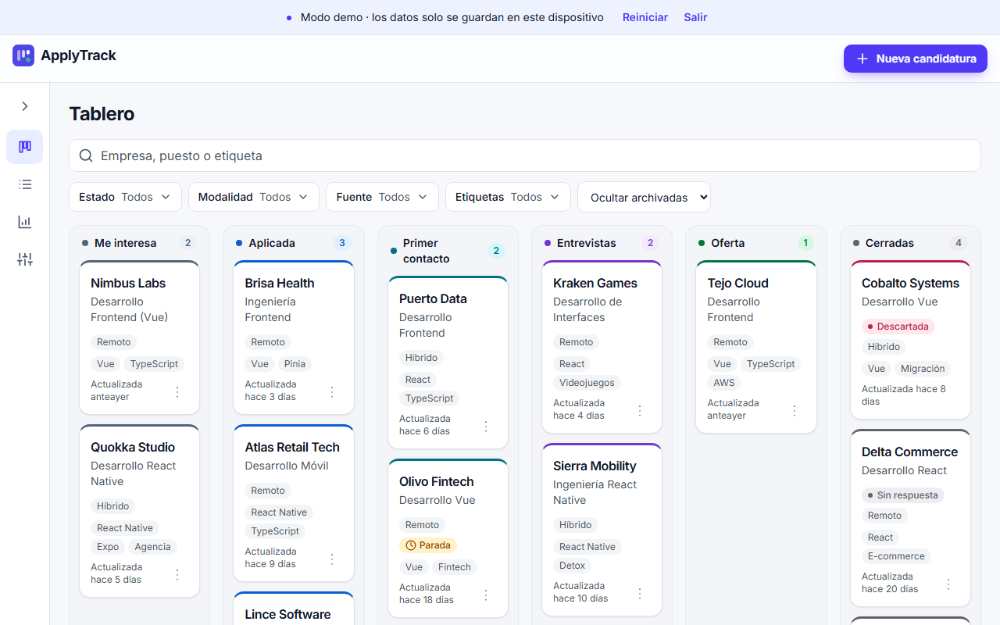
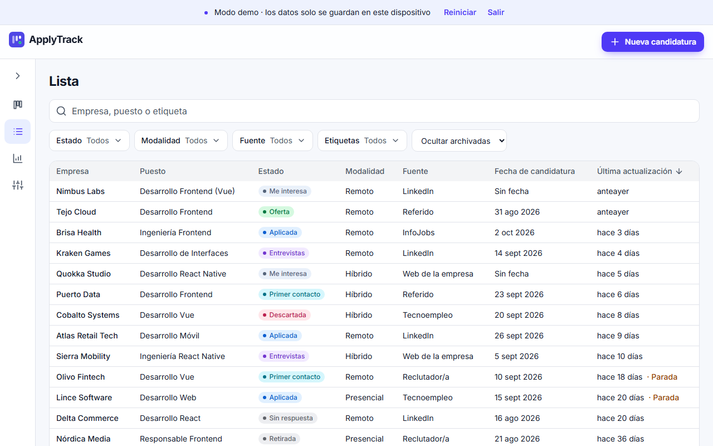
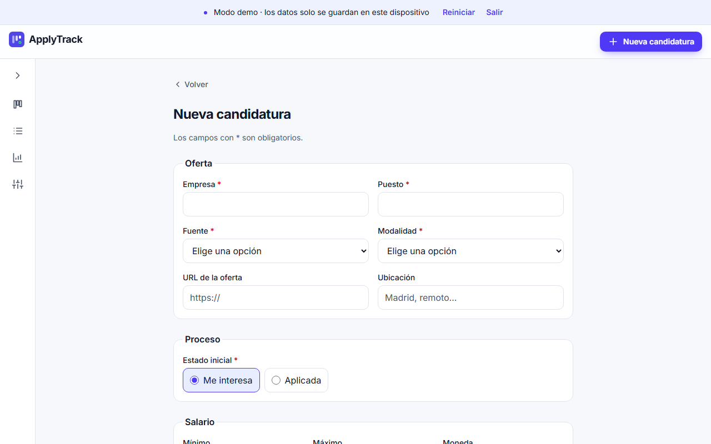
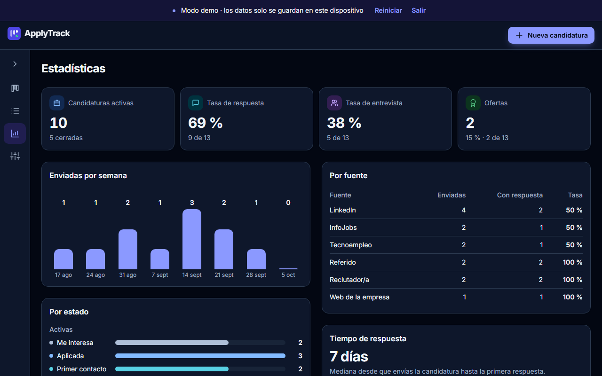
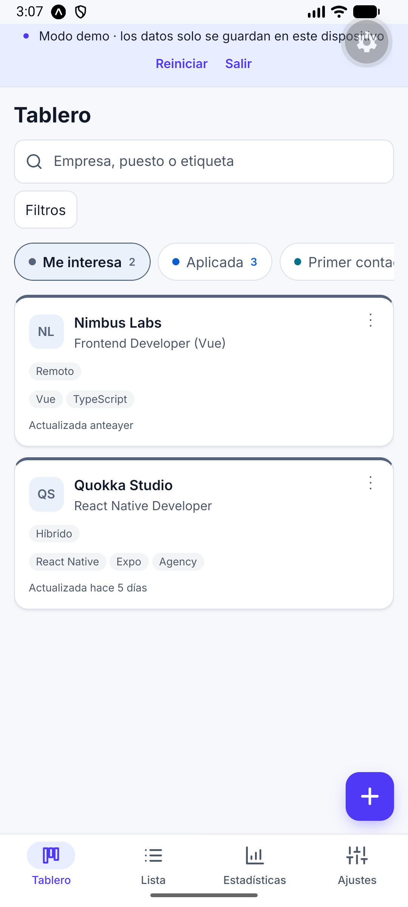
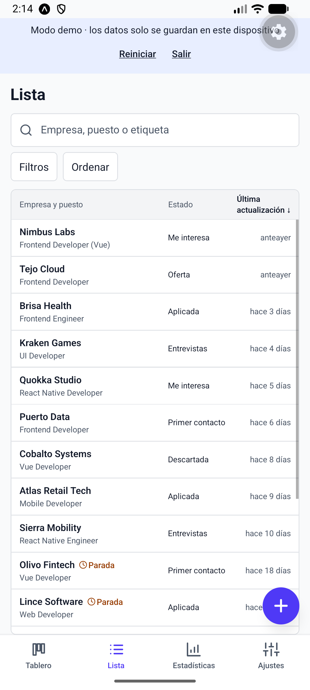
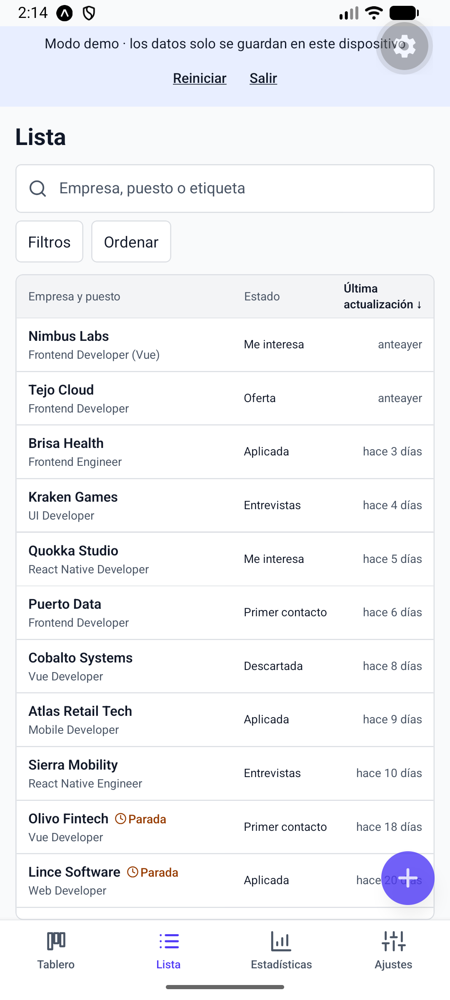
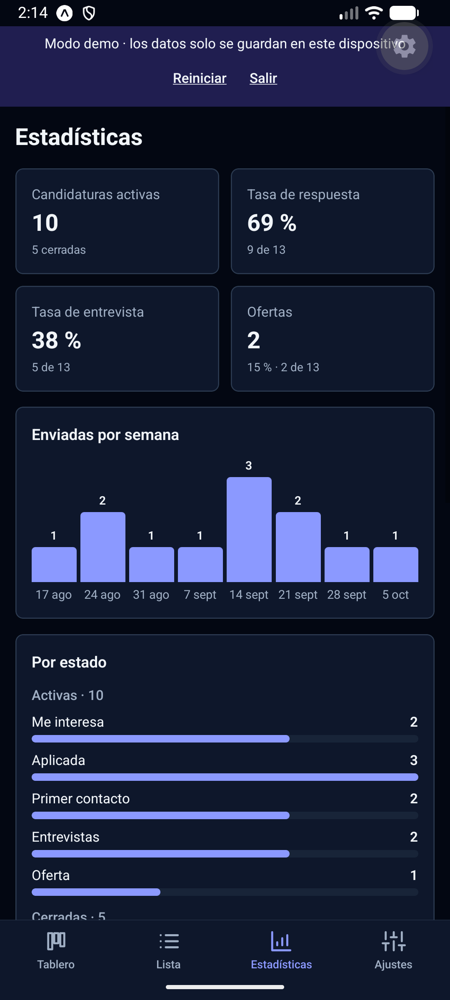

<p align="center"></p>

# ApplyTrack

**English** | [Español](README.es.md)

[](https://github.com/srdgz/applytrack/actions/workflows/ci.yml)
[](https://applytrack-roan.vercel.app)

Job application tracker with a **web app (Vue 3)** and a **mobile app (React Native + Expo)** that share a domain core built with **hexagonal architecture**, written in TypeScript and developed with **Spec-Driven Development**.

**Try it at [applytrack-roan.vercel.app](https://applytrack-roan.vercel.app)**: press "Probar sin cuenta" (try without an account), or sign in with your email. The interface is available in Spanish and English.

## Screenshots

<table>
  <tr>
    <th></th>
    <th>Board</th>
    <th>List</th>
    <th>New application</th>
    <th>Stats</th>
  </tr>
  <tr>
    <th>Web</th>
    <td></td>
    <td></td>
    <td></td>
    <td></td>
  </tr>
  <tr>
    <th>App</th>
    <td align="center"></td>
    <td align="center"></td>
    <td align="center"></td>
    <td align="center"></td>
  </tr>
</table>

## Features

- **Passwordless accounts:** a magic link by email, with the data in Supabase and Row Level Security.
- **Demo mode without signing up:** 15 sample applications stored only on the device.
- **Board** by status, each with its own colour, with drag and drop (mouse) and a "Move to…" menu (keyboard and touch).
- **List** with column sorting, accent-insensitive search and filters (kept in the URL on the web).
- **Create and edit form** with live validation and the same rules as the domain.
- **Detail** with the history of status changes and only the allowed transitions.
- **Stats:** response, interview and offer rates, weekly activity, results by source and stale applications.
- **Archive, unarchive and delete.**
- **Toasts** inspired by [Sileo](https://sileo.aaryan.design): seven types, promises and "Undo".
- **Spanish and English**, light, dark or system theme (saved in the profile), and a responsive layout from 320 px to 2560 px.
- **The mobile app has the same features** as the web, with native components.

## Getting started

### In the browser

Open [applytrack-roan.vercel.app](https://applytrack-roan.vercel.app) and press "Probar sin cuenta" to see the web app with 15 sample applications stored only in your browser, or sign in with your email to save your own.

### Mobile app

The app is not published on the stores: you run it from the source code with [Expo Go](https://expo.dev/go) or in an emulator.

1. Install **Expo Go** on your phone from the App Store or Google Play.
2. Clone the repository and install the dependencies (requirements in the next section):
   ```bash
   git clone https://github.com/srdgz/applytrack.git
   cd applytrack
   pnpm install
   ```
3. Start the app and scan the QR code shown in the terminal, with the camera on iOS or from Expo Go on Android. The phone and the computer must be on the same network.
   ```bash
   pnpm dev:mobile
   ```
4. Press "Probar sin cuenta". To sign in with your email, start with `pnpm dev:mobile:tunnel` (Supabase does not accept redirect links to a local IP address) and set up `apps/mobile/.env.local` as explained below.

**On your computer:** `pnpm dev:android` opens it in the Android emulator (it needs Android Studio with a virtual device; Expo installs Expo Go if needed) and `pnpm dev:ios` in the iOS simulator, on macOS only.

### Running locally

Requirements: **Node 24** (at least 22.12, see `.nvmrc`) and **pnpm 12**.

```bash
pnpm install
pnpm dev:web            # web app at http://localhost:5173
pnpm dev:mobile         # app in Expo Go: scan the QR code
pnpm dev:mobile:tunnel  # same, through a tunnel: needed to sign in with email in Expo Go
pnpm dev:android        # app in the Android emulator
pnpm dev:ios            # app in the iOS simulator (macOS only)
```

- **With no setup,** the web and mobile apps work in **demo mode**: press "Probar sin cuenta".
- **For accounts,** copy `apps/web/.env.example` and `apps/mobile/.env.example` to `.env.local` in the same folder, with the URL and publishable key of a Supabase project, and apply the migrations with `pnpm supabase link` and `pnpm supabase db push`. The full steps are in [spec 104](docs/specs/104-autenticacion.md#8-configuración-del-proyecto-en-supabase).

## Architecture

```
apps/
  web/              Vue 3 · Vite · Tailwind CSS 4 · vue-router · vue-i18n
  mobile/           Expo · Expo Router · NativeWind · i18next
packages/
  core/             Domain and use cases. No runtime dependencies.
  adapter-local/    Demo mode repository on localStorage / AsyncStorage
  adapter-supabase/ Repository, session, access and profile on Supabase
  composition/      Composition root shared by the web and mobile apps
  presentation/     Filters, formatting and form logic shared by the web and mobile apps
  i18n/             Shared ES/EN catalogues in ICU format
  notifications/    Toast queue shared by the web and mobile apps
  design-tokens/    Colours shared by the web and mobile apps
  config/           Shared tsconfig and ESLint
brand/              SVG logo; `pnpm brand` generates the web and app icons
supabase/           SQL migrations with RLS, local config and the email template
docs/
  specs/            Specifications with acceptance criteria
  adr/              Architecture decision records
  screenshots/      Screenshots generated for this README
```

- **Ports and adapters:** `core` defines the ports (repository, session, access, clock…) and the adapters implement them. The apps only wire the pieces together in their `di/` folder.
- **Rules checked in CI** with `dependency-cruiser`: the domain imports nothing external, `core` uses no npm packages, the UI does not import adapters and there are no circular dependencies.
- **Business errors as data:** use cases return a `Result` with error codes, and the UI translates them.
- **Contract suite:** the in-memory, local and Supabase repositories pass the same tests for search, sorting, pagination and isolation between users.

## Quality

| What                  | How                                                                                                                                  |
| --------------------- | ------------------------------------------------------------------------------------------------------------------------------------ |
| Unit tests            | Vitest in the packages and the web app; Jest and Testing Library in the mobile app. `core` above 90 % coverage.                      |
| Contract and security | The contract suite and the RLS tests against a local Supabase in CI.                                                                 |
| Architecture          | `dependency-cruiser` on every PR.                                                                                                    |
| Web E2E               | Playwright at 360, 768, 1280 and 1920 px, including a keyboard-only walkthrough and no horizontal scrolling.                         |
| Accessibility         | WCAG 2.2 AA. axe on the main screens, in the light and dark themes, with no serious violations.                                      |
| Performance           | Lighthouse on mobile: 100 for performance, accessibility and best practices. 132 KB of initial JavaScript gzipped, capped at 200 KB. |
| Mobile E2E            | Maestro in the Android emulator with Expo Go (`pnpm e2e:mobile`).                                                                    |
| Copy                  | Key parity between languages and lint rules that block untranslated text.                                                            |

| Command                   | What it does                                               |
| ------------------------- | ---------------------------------------------------------- |
| `pnpm lint`               | ESLint in every package                                    |
| `pnpm typecheck`          | Type checks with TypeScript                                |
| `pnpm test`               | Vitest (packages and web) and Jest (mobile), with coverage |
| `pnpm depcruise`          | Dependency rules of the hexagonal architecture             |
| `pnpm format`             | Formats the code with Prettier                             |
| `pnpm build`              | Builds the web app                                         |
| `pnpm e2e`                | Web E2E and accessibility with Playwright and axe          |
| `pnpm lighthouse`         | JavaScript budget and Lighthouse on mobile                 |
| `pnpm e2e:mobile`         | Mobile E2E with Maestro (with `pnpm dev:android` running)  |
| `pnpm screenshots`        | Web screenshots for this README                            |
| `pnpm screenshots:mobile` | App screenshots for this README                            |

The first time, `pnpm --filter @applytrack/web e2e:install` downloads Chromium inside the project. Maestro is installed separately by following [its guide](https://docs.maestro.dev/getting-started/installing-maestro) and needs Java 17 or later.

## Documentation

The specifications and architecture decisions are written in Spanish.

| Document                                                                    | Contents                                              |
| --------------------------------------------------------------------------- | ----------------------------------------------------- |
| [000 · Product](docs/specs/000-producto.md)                                 | Vision, scope, domain model and requirements          |
| [001 · Architecture](docs/specs/001-arquitectura.md)                        | Hexagonal, SOLID, monorepo, data and testing          |
| [002 · i18n](docs/specs/002-i18n.md)                                        | Spanish and English: catalogues, formats and checks   |
| [003 · Responsive](docs/specs/003-responsive.md)                            | Breakpoints and the behaviour of each screen          |
| [004 · Roadmap](docs/specs/004-hoja-de-ruta.md)                             | Milestones and the status of each specification       |
| [100 · Create and edit](docs/specs/100-crear-y-editar-candidatura.md)       | Validation, use cases and form                        |
| [101 · Status change](docs/specs/101-cambio-de-estado.md)                   | Transitions, detail and moves on the board            |
| [102 · Board and list](docs/specs/102-tablero-y-lista.md)                   | Search, filters, sorting and pagination               |
| [103 · Demo mode](docs/specs/103-modo-demo.md)                              | Local adapter and sample data                         |
| [104 · Authentication](docs/specs/104-autenticacion.md)                     | Magic link, preferences and Supabase                  |
| [105 · Stats](docs/specs/105-panel-estadisticas.md)                         | Metrics and dashboard                                 |
| [106 · Archive and delete](docs/specs/106-archivar-y-eliminar.md)           | Reversible archiving and deletion with confirmation   |
| [107 · Notifications](docs/specs/107-notificaciones.md)                     | Toasts shared by the web and mobile apps              |
| [108 · Visual identity](docs/specs/108-identidad-visual.md)                 | Logo, icons and splash screen                         |
| [109 · Mobile app foundation](docs/specs/109-base-app-movil.md)             | Navigation, demo mode, access and settings on mobile  |
| [110 · Mobile board and list](docs/specs/110-tablero-y-lista-movil.md)      | Board, list, search and filters on mobile             |
| [111 · Mobile detail](docs/specs/111-detalle-movil.md)                      | Detail, status change, archive and delete on mobile   |
| [112 · Mobile form](docs/specs/112-formulario-movil.md)                     | Creating and editing applications on mobile           |
| [113 · Mobile stats](docs/specs/113-estadisticas-movil.md)                  | Stats dashboard on mobile                             |
| [114 · Web quality](docs/specs/114-calidad-web.md)                          | E2E, accessibility, performance and untranslated text |
| [115 · Mobile quality and README](docs/specs/115-calidad-movil-y-readme.md) | E2E with Maestro and screenshots                      |
| [116 · Visual redesign](docs/specs/116-rediseno-visual.md)                  | Status colours, Inter and surfaces                    |
| [117 · Web deployment](docs/specs/117-despliegue-web.md)                    | Vercel, Supabase in production and how to run the app |
| [ADR](docs/adr)                                                             | Architecture decision records                         |

## Tech stack

**In use:** TypeScript · Vue 3 · Vite · Tailwind CSS 4 · Inter · vue-router · vue-i18n · React Native · Expo · Expo Router · NativeWind · i18next · Supabase (Auth, Postgres, RLS) · Zod · Vitest · Testing Library · Jest · Playwright · axe · Lighthouse · Maestro · ESLint · Prettier · dependency-cruiser · pnpm · Turborepo · Husky · commitlint · GitHub Actions · Vercel

## How it is built

Spec-Driven Development: every feature starts with a specification with acceptance criteria in `docs/specs`. Once it is approved, it is implemented, tested against those criteria and the changes are recorded in the specification itself.

## License

[MIT](LICENSE) © 2026 Sandra Rodríguez
